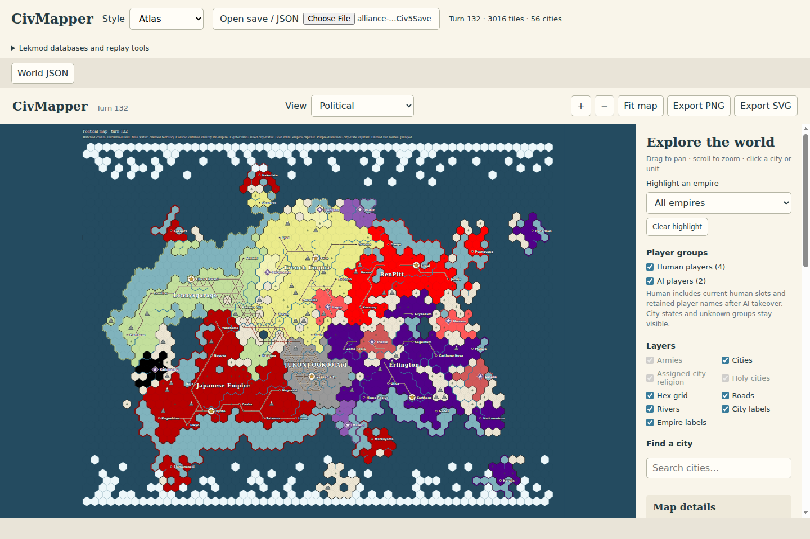
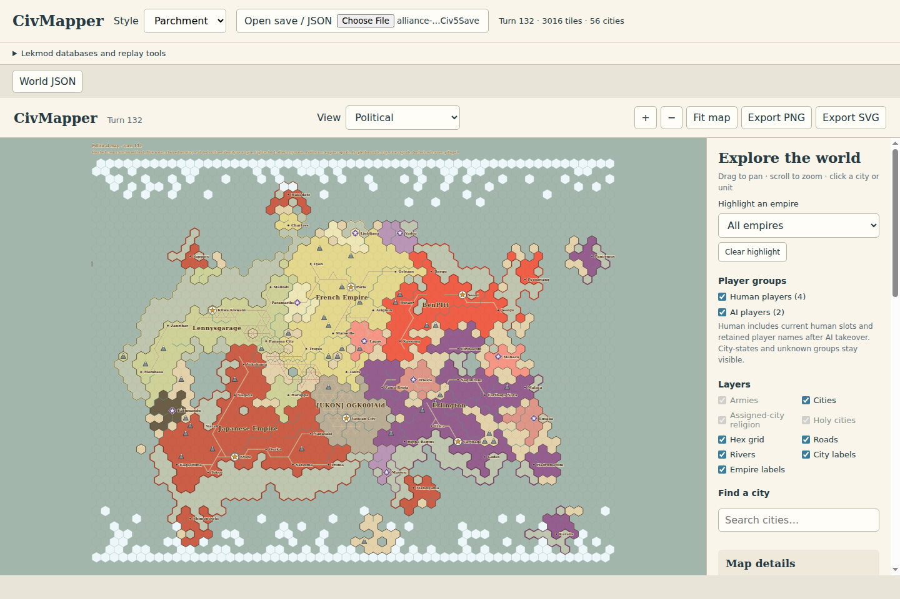
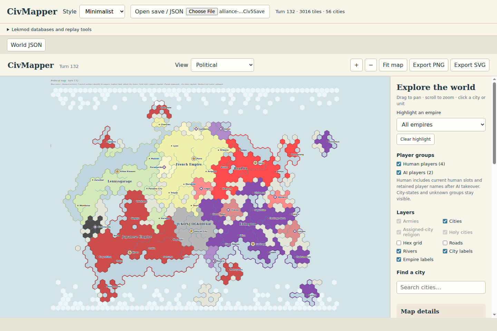

# CivMapper

Civilization V saves and replays → JSON, political maps and interactive exports.
MIT-licensed, experimental TypeScript core shared by a Node CLI and a static,
browser-only application. No Python installation or upload backend is required.

The supported save layouts reconstruct geography, ownership and current cities
without the original `.Civ5Map`. This is a validated-format prototype: unknown
layouts fail explicitly. The migration matches the previous implementation on
138 copied saves and 59 replay files; 56 replays parse and three legacy formats
remain unsupported. A turn 132 multiplayer example is bundled for optional
exploration; other private saves are never bundled. Compact default Lekmod
metadata supplies names, terrain, colors and military classification.
See [format evidence and limitations](docs/feasibility.md).

## Screenshots

The same real multiplayer save at turn 132, shown in each built-in style.
Click any screenshot to view it at full size.

[](docs/images/browser-atlas.png)

**Atlas** — vivid empire colors, deep blue oceans and detailed geography.
The sidebar provides empire highlighting, player filters and layer toggles;
PNG and SVG exports capture the current view.

| Parchment | Minimalist |
| --- | --- |
| [](docs/images/browser-parchment.png) | [](docs/images/browser-minimalist.png) |
| Warm inks, muted water and serif labels. | Lighter colors, with roads and the hex grid off by default. |

## Browser application

Install Node **22.12+**, then:

```sh
npm ci
npm run dev
```

Open the local URL printed by Vite. Choose or drop a `.Civ5Save` or normalized
world JSON, or click **Load example** on the welcome screen. The example
is fetched and opened only when requested; the app starts with an empty map.
Select a style, explore the political, physical and army views,
then use **Export PNG** or **Export SVG** inside the map viewer. Exports use the
current viewport, layers, player filters and highlighted empire. **Fit map**
exports the whole world. World JSON is available above the viewer.

Parsing, decompression, database enrichment and GIF rendering run in a
worker. **Cancel** interrupts that worker and preserves the last valid map.
Inputs stay in session memory; there are no save upload requests, analytics or
remote assets. Reloading the page clears the session.

The bundled **Lekmod** lookup databases load automatically with a save, enabling
readable city names, physical terrain and detailed armies for matching saves.
For another version, expand **Lekmod databases and replay tools** and select
matching `Civ5DebugDatabase.db` and `Localization-Merged.db` from the game's cache.
The current map updates automatically while keeping its viewport and filters.
Unmatched metadata is reported visibly; unresolved units remain unknown and
army view stays disabled. All databases are read without modification.

Load `.Civ5Replay`, a supported save's embedded replay, or exported replay JSON
from the same panel. A standalone replay needs a matching base map or an
explicit wrap choice. Playback, previous/next and a turn slider follow eventful
turns. Captions and GIF downloads are available. Historical armies, capitals,
roads and alliances are absent from replay logs and are never projected from
the final save. [Replay details](docs/replays.md).

## Static hosting

```sh
npm run build
npm run preview
```

Publish **`dist/web/`** as static files. It contains the page, worker, WASM and
licensed font assets and default metadata, with relative URLs for both root and project-subdirectory
hosting. No application server or API is deployed. Use HTTP(S) for this app;
individual downloaded map HTML files also work directly from `file://`.

[Hosting instructions](docs/browser.md) cover Cloudflare Pages and Workers static hosting.

## CLI

```sh
npm run build
node dist/cli/index.js --help
# Optional: register the local command
npm link
```

With the local command registered:

```sh
civmapper render-save '/path/to/game.Civ5Save'
civmapper render-save '/path/to/game.Civ5Save' --style parchment -o map.svg
civmapper render-save '/path/to/game.Civ5Save' --mode physical -o terrain.png
civmapper render-save '/path/to/game.Civ5Save' --mode army \
  --army-icons detailed --military-summary -o army.html
```

The default output is `artifacts/<save-name>[-physical|-army].png`. Files can
live anywhere; quote native paths containing spaces. `render-save` automatically
looks for matching databases in the current directory's `artifacts/ruleset/`.
`--no-enrichment` disables this lookup; explicit database paths are supported.
PNG/GIF dependencies are installed with npm and run locally through WASM.

```sh
civmapper extract game.Civ5Save --units \
  --ruleset matching.db --localization localization.db -o world.json
civmapper render world.json --mode army -o map.html
civmapper inspect game.Civ5Save -o inspection.json --dump-state state.bin
civmapper styles
civmapper extract-replay game.Civ5Save -o replay.json
civmapper render-replay --replay game.Civ5Save \
  --captions --maxturns 20 --duration 300 -o replay.gif
civmapper render-replay --map base.Civ5Map --replay game.Civ5Replay -o replay.gif
```

`render-replay` also accepts replay JSON, normalized/scenario map JSON, explicit
`--owner-map`, `--wrap-x`/`--no-wrap-x`, physical mode and SVG output of the last
selected frame. `--maxturns` counts eventful turns; zero means all. Errors exit
**2**, and outputs cannot overwrite inputs or databases. `serve` has been removed.

## Map features and data

- `atlas`, `parchment`, `minimalist` presets, or custom JSON styles.
- Exact pointy hex geography, merged territories, coasts and ownership borders.
- Distinct owned/unclaimed water, patterned unclaimed land, mountains, forests,
  rivers, roads and railroads where verified.
- Gold empire-capital stars, purple city-state diamonds, and allied city-state
  shading with a single city label.
- Saved multiplayer display names as empire labels. Human grouping includes
  current human slots and retained player names after AI takeover, including
  lobby names. Optional turn-1 evidence does not change this default.
- Army symbols at actual unit positions, count badges for stacks of two or more,
  optional detailed roles and empire summaries. Civilians, city-state armies
  and barbarians are excluded. Counts measure units rather than strength.
- Interactive zoom/pan, city search, feature details, layers, player-group
  toggles, empire highlighting and visible-region PNG/SVG export.

The parser and renderer communicate through the unchanged
[world JSON contract](docs/normalized-json.md) and [schemas](schemas).
Unowned, unknown and unavailable fields remain explicit. Lakes, elimination,
custom civilization-name overrides and off-map/trade-manager units remain
limitations. Physical mode needs resolved terrain; army mode needs extracted
units and matching ruleset classification. [Interactive export details](docs/html-export.md).

## Development and verification

```sh
npm run build
npm run check
npm test
node scripts/validate_corpus.mjs artifacts/save-corpus -o artifacts/corpus-report.json
node scripts/validate_replays.mjs artifacts/replay-corpus -o artifacts/replay-report.json
node scripts/validate_units.mjs artifacts/save-corpus -o artifacts/unit-report.json
node scripts/validate_html.mjs map.html /path/to/chrome artifacts/browser-report.json
```

318 automated tests cover binary fixtures, truncation, mismatches, SVG parity,
SQLite metadata, CLI behavior and PNG/GIF exports. Tests include 312 synthetic
comparison cases captured from the retired Python implementation. The
[TypeScript migration report](docs/typescript-migration.md) records real-file
comparisons and browser checks. The optional turn 132 example is the only real
save included in the repository (`examples/turn-132.Civ5Save`). The site ships
only its generated JSON, decoded and enriched during the build.

`examples/synthetic-world.json`, `examples/synthetic-map.svg` and
`examples/synthetic-replay.json` are explicitly fictional fixtures, never
substituted for extracted game data. Regenerate the world with
`node examples/make_synthetic.mjs`.

Architecture: `packages/core` contains portable format/rendering logic;
`packages/cli` handles filesystem access; `packages/web` handles UI and the worker.
See [NOTICE](NOTICE) for format attribution and [third-party licenses](third_party).

### Tourism influence

Select **Tourism influence** to see each empire’s own territory shaded by total accumulated tourism exported on a shared scale. Click an empire for its outgoing influence and ranked totals; clear selection to return to the overview. The CLI supports `--mode culture` for the overview and optional `--perspective <player-id>` for SVG, PNG and HTML current-state output. Selected-source shading shows recorded tourism divided by target lifetime culture; unknown data is hatched. [Supported layouts, availability and normalized data](docs/cultural-view.md).

Religion maps are available in the browser's View selector and in the CLI:

```sh
civmapper render-save game.Civ5Save --mode religion --output religion.svg
civmapper render examples/synthetic-religion.json --mode religion --output religion.html
```

City circles show the current religious majority; a diamond marks holy status
independently. Land colors follow the city's saved territory assignment. Gray
means unknown. The view is enabled only when city religion records are known;
unsupported save structures and replays retain the other available views.
Supply matching ruleset/localization databases for mod names. Bundled religion
labels use default ID mappings, and verified saved custom names take precedence.

The religion view includes named color keys, a faith selector, and clickable
follower/city summaries. Click a territory or religion to highlight that faith
across empires; clear it to return to the overview. City circles show current
majority while colored diamonds identify holy faiths independently. Counts
cover decoded cities only; unknown records remain explicit.

Selected faiths use a follower-share heatmap, including minority presence.
Territories use their saved assigned city’s follower share; circles show city
shares and diamonds retain the holy religion’s color. Standard faith colors are
distinct, including Catholicism and Eastern Orthodoxy.
